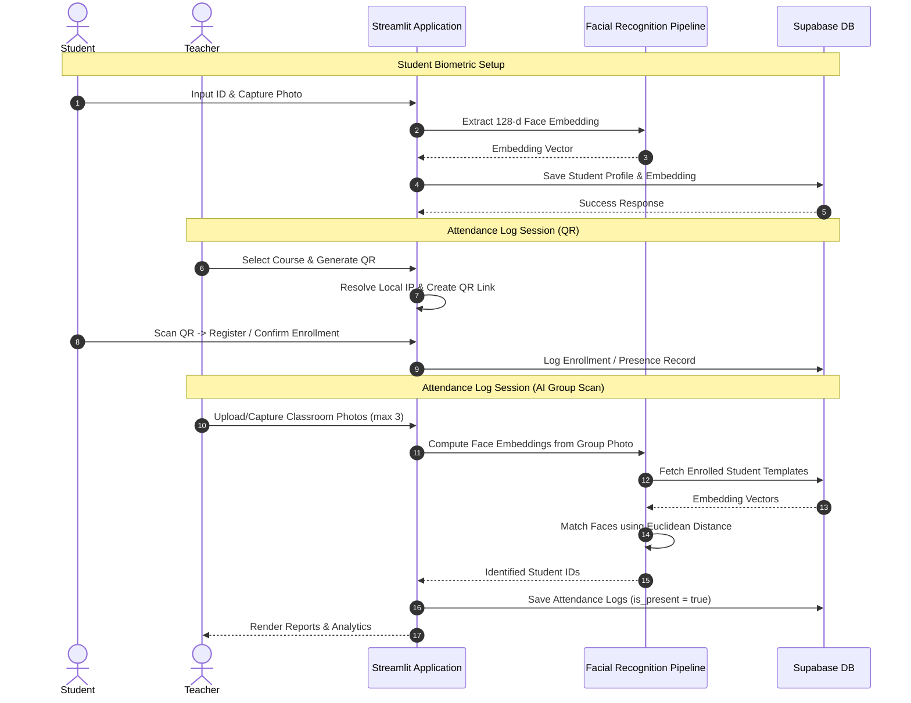

# AttendX AI 📚✨

> 🚀 **Live Demo:** Access the live deployed application at **[https://snap-attend-jr.streamlit.app/](https://snap-attend-jr.streamlit.app/)**

[](https://snap-attend-jr.streamlit.app/)
[](https://www.python.org/)
[](https://streamlit.io/)
[](https://supabase.com/)
[](https://opensource.org/licenses/MIT)

**AttendX AI** (Snap-Attend) is a modern, high-performance, and beautifully styled AI-powered biometric attendance tracking system. By combining computer vision pipelines with cloud-native backends, AttendX AI enables automated student check-in, dynamic classroom QR session routing, and instant group-photo presence logging.

---

## 🚀 Core Features

*   **📸 Biometric Student Setup**: Students register their profiles by capturing a high-definition photo. The pipeline detects landmarks and extracts a **128-dimensional facial embedding vector** to store in the database.
*   **📱 Dynamic QR Attendance Sessions**: Teachers can generate session-specific QR codes. When scanned by students on the local network, they are automatically routed to the enrollment/check-in pages with class contexts preloaded.
*   **🤖 AI Group Face Scanning**: Teachers capture or upload classroom photographs. The system detects all faces in the group, computes their embeddings, and matches them using **minimum Euclidean distance (L2 norm) classification** against enrolled templates to log presence automatically.
*   **📊 Reports & Insights**: Dedicated reports dashboard displaying presence tables, percentage metrics, class lists, and instant CSV/Excel spreadsheet exports.
*   **🎨 Premium UX Design**: Embedded customized styling containing glassmorphic hover animations, custom form input focus rings, clean FontAwesome toggles, and base64-encoded logo loaders.

---

## 🛠️ Tech Stack & Algorithms

*   **Frontend Interface**: [Streamlit](https://streamlit.io/) (with vanilla CSS injections).
*   **Cloud Backend & Database**: [Supabase](https://supabase.com/) (PostgreSQL).
*   **Face Recognition Pipeline**:
    *   **Dlib Frontal Face Detector**: Locates bounding boxes of human faces.
    *   **5-point Shape Predictor**: Determines face landmarks (eyes, nose, mouth).
    *   **ResNet-101 Model**: Translates landmark coordinates into a high-precision 128-dimensional representation.
    *   **L2 Norm Distance Matching**: Identifies students by calculating minimum Euclidean distance ($d = \sqrt{\sum (p_i - q_i)^2}$) with a strict classification threshold (0.6).
*   **QR Encoding Engine**: [Segno](https://github.com/heuer/segno) (generates high-definition vector QR codes).
*   **Data Processing**: Pandas & Numpy.

---

## 📐 System Workflow



---

## 🗃️ Database Schema

AttendX AI uses five main tables configured in Supabase. You can find the SQL queries to create them in [schema.sql](schema.sql):

```
                     +-------------------+
                     |     teachers      |
                     +-------------------+
                     | PK | teacher_id   |
                     |    | username     |
                     |    | password     |
                     |    | name         |
                     +-------------------+
                               |
                               | 1:N
                               v
                     +-------------------+
                     |     subjects      |
                     +-------------------+
                     | PK | subject_id   |
                     |    | subject_code |
                     |    | name         |
                     |    | section      |
                     | FK | teacher_id   |
                     +-------------------+
                               |
            +------------------+------------------+
            | 1:N                                 | 1:N
            v                                     v
+-----------------------+             +-----------------------+
|   subject_students    |             |    attendance_logs    |
+-----------------------+             | (Historical Sessions) |
| PK,FK | student_id    |             +-----------------------+
| PK,FK | subject_id    |             | PK    | id            |
+-----------------------+             | FK    | student_id    |
            ^                         | FK    | subject_id    |
            | N:1                     |       | is_present    |
+-----------------------+             +-----------------------+
|       students        |                         ^
+-----------------------+                         |
| PK | student_id       |-------------------------+
|    | name             | 1:N
|    | face_embedding   |
+-----------------------+
```

---

## ⚙️ Installation & Setup

Follow these steps to run AttendX AI on your local development machine:

### 1. Prerequisites
Ensure you have **Python 3.10+** and **git** installed. Dlib requires C++ build tools; on Windows, make sure you have "Desktop development with C++" selected in Visual Studio Installer.

### 2. Clone the Repository
```bash
git clone https://github.com/yourusername/snap-attend.git
cd snap-attend
```

### 3. Create a Virtual Environment
```bash
python -m venv .venv
# Activate on Windows:
.venv\Scripts\activate
# Activate on macOS/Linux:
source .venv/bin/activate
```

### 4. Install Dependencies
```bash
pip install -r requirements.txt
```

### 5. Configure Environment Variables
Copy the env template file and enter your Supabase connection strings:
```bash
cp .env.example .env
```
Open `.env` (or setup `.streamlit/secrets.toml` in the same structure) and fill in the values:
```env
SUPABASE_URL=https://your-project-id.supabase.co
SUPABASE_PUBLISHABLE_KEY=your-supabase-anon-key
```

### 6. Create Database Tables
Go to your **Supabase Dashboard -> SQL Editor** and execute the commands located in [schema.sql](schema.sql).

### 7. Run the Application
```bash
streamlit run app.py
```

---

## 📂 Project Structure

```
├── .streamlit/             # Streamlit configuration and secrets
├── src/
│   ├── components/         # Reusable page components (e.g. Header)
│   ├── database/           # Supabase adapter client and queries
│   ├── images/             # Static graphics (logos, portals)
│   ├── pipelines/          # AI computer vision and embedding algorithms
│   ├── screens/            # Home, Student Setup, and Teacher Workspace views
│   └── ui/                 # CSS variables, inputs styling, layouts
├── uploads/                # Temporary directory for scanned classroom images
├── app.py                  # Entrypoint routing script
├── schema.sql              # Database initialization statements
├── requirements.txt        # Package dependencies
└── README.md               # Documentation
```

---

## 📄 License
This project is open-source and available under the [MIT License](LICENSE).

---
*Created with ❤️ by Jagan Ramadugu*
